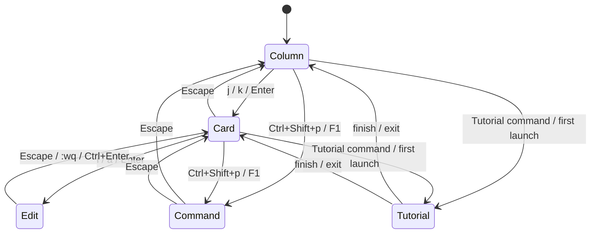

# Jot Deck キーバインド仕様

## 1. 設計方針

### 1.1 基本原則
* **Vim + Twitter ハイブリッド:** `h/j/k/l` による Vim ライクなナビゲーションと、`g` プレフィックスによる Twitter ライクなジャンプを組み合わせる。
* **フォーカスベース:** フォーカス対象（Column / Card）によって同じキーが異なる動作を行う。
* **修飾キー最小化:** 頻繁な操作は修飾キーなしで実行可能。
* **カスタマイズ可能:** ユーザーが全キーバインドを変更可能。

### 1.2 フォーカスモデル

アプリケーションは以下のフォーカス状態を持つ：

| フォーカス | 説明 | 遷移方法 |
|:---|:---|:---|
| **Column** | カラムヘッダーにフォーカス。カラム単位の操作が可能。 | Card フォーカス時に `Escape`、または空のカラムを選択 |
| **Card** | カード本体にフォーカス。カード単位の操作が可能。 | Column フォーカス時に `j` / `k` / `↑` / `↓` / `Enter` |
| **Edit** | カード内テキスト編集中。CodeMirror がアクティブ。 | Card フォーカス時に `i` / `a` / `Enter` |
| **Command** | コマンドパレット表示中。 | `Ctrl+Shift+p` / `F1` |
| **Tutorial** | チュートリアルのガイドオーバーレイ表示中。下層フォーカスに被さる**一時レイヤー**。ハンズオン中（Observe）は `Escape` を含む全キーを下層へ透過して観測に徹し、`Tab` でコーチマークへ移ると中断・前後移動などの UI 操作（Control）が可能。終了時は元のフォーカスへ復帰。 | 初回起動ダイアログ / コマンドパレット「Tutorial」 |

> **Note:** `Tutorial` は通常のフォーカス遷移とは異なり、下層の Column / Card / Edit に重ねて表示される一時オーバーレイ。詳細は `docs/006-tutorial.md` 4.2 を参照。

> **Streaming（AI 生成中の read-only）:** Reporter がストリーム中のカード（`007-reporter-protocol.md` §6.2 の `card.stream.begin`〜`end`）は、そのカード単位で read-only になる。グローバルなフォーカスモードは追加せず（複数カラムのカードが同時にストリームし得るため）、当該カードだけが編集突入（`i` / `a` / `Enter` / クリック）を弾かれ、`◍ AI generating` を表示する。ユーザは他カードへ自由にナビゲートでき、`end`（確定）でロックが解放されると通常の編集に戻る。

---

## 2. Column フォーカス

カラムヘッダーにフォーカスがある状態。カラム単位の操作を行う。

### 2.1 ナビゲーション

| キー | 動作 |
|:---|:---|
| `h` / `←` | 左のカラムへフォーカス移動（最初のカラムからは最後のカラムへ） |
| `l` / `→` | 右のカラムへフォーカス移動（最後のカラムからは最初のカラムへ） |
| `j` / `↓` | Card フォーカスへ遷移（カラム内の最初のカードを選択） |
| `k` / `↑` | Card フォーカスへ遷移（カラム内の最後のカードを選択） |
| `Enter` | Card フォーカスへ遷移（カラム内の最初のカードを選択） |
| `g 1` 〜 `g 9` | n 番目のカラムへ移動（Twitter 風） |

### 2.2 カラム操作

| キー | 動作 |
|:---|:---|
| `H` / `Shift+←` | カラムを左へ移動（並び替え。最初のカラムは末尾へ） |
| `L` / `Shift+→` | カラムを右へ移動（並び替え。最後のカラムは先頭へ） |
| `o` | 現在のカラムに新規カード作成 → Edit フォーカス |
| `n` | 現在のカラムに新規カード作成 → Edit フォーカス（`o` のエイリアス、Twitter 風） |
| `c` | 新規カラム作成（現在のカラムの右） |
| `N` | 新規カラム作成（`c` のエイリアス） |
| `Ctrl+w` | カラムを削除（`u` で Undo 可能） |
| `d d` | カラムを削除（`Ctrl+w` と同等） |
| `Delete` | カラムを削除 |
| `r` | カラム名を編集 |

### 2.3 カラム名の編集

`r`（Column / Card フォーカス）、カラムヘッダーのダブルクリック、またはカラムパレットの「Rename column」で、カラムヘッダーの名前がその場で入力欄になる。入力欄は現在の名前を全選択した状態で開く。

| キー | 動作 |
|:---|:---|
| `Enter` | 名前を確定する（IME の変換確定の `Enter` では確定しない） |
| `Escape` | 変更を破棄して元の名前に戻す |

* 保存動作はカードの編集（§5）に準じる。フォーカスを外しても入力欄と入力中の名前は残り、自動では確定しない。再度 `r` またはダブルクリックで入力欄へ戻れる
* 別のカラムの名前変更やカードの編集を始めるか、Deck を切り替えると、開いている名前変更は確定される
* 空（空白のみ）または元と同じ名前で確定した場合は、変更なしとして入力欄を閉じる
* 確定した名前変更は Undo 履歴に積まれる

---

## 3. Card フォーカス

カード本体にフォーカスがある状態。カード単位の操作を行う。

### 3.1 ナビゲーション

| キー | 動作 |
|:---|:---|
| `j` / `↓` | 下のカードへ移動（最後のカードからは最初のカードへ） |
| `k` / `↑` | 上のカードへ移動（最初のカードからは最後のカードへ） |
| `h` / `←` | 左のカラムへ移動（同じ行位置を維持。最初のカラムからは最後のカラムへ） |
| `l` / `→` | 右のカラムへ移動（同じ行位置を維持。最後のカラムからは最初のカラムへ） |
| `H` / `Shift+←` | カードを左のカラムへ移動（最初のカラムからは最後のカラムへ） |
| `L` / `Shift+→` | カードを右のカラムへ移動（最後のカラムからは最初のカラムへ） |
| `J` / `Shift+↓` | カードをカラム内で下へ移動（並び替え。最後のカードは先頭へ） |
| `K` / `Shift+↑` | カードをカラム内で上へ移動（並び替え。最初のカードは末尾へ） |
| `g g` / `Ctrl+↑` | カラム内の最初のカードへ |
| `G` / `Ctrl+↓` | カラム内の最後のカードへ |
| `g 1` 〜 `g 9` | n 番目のカラムへ移動（Twitter 風） |
| `Ctrl+u` / `PageUp` | 半ページ上へスクロール |
| `Ctrl+d` / `PageDn` | 半ページ下へスクロール |
| `Escape` | Column フォーカスへ遷移 |

### 3.2 カード操作

| キー | 動作 |
|:---|:---|
| `i` / `I` | Edit フォーカスへ（前回保存時のカーソル位置、なければカード先頭。Insert モード） |
| `a` / `A` | Edit フォーカスへ（カード末尾にカーソル、Insert モード） |
| `o` | 現在のカードの下に新規カード作成 → Edit フォーカス |
| `n` | 現在のカードの下に新規カード作成 → Edit フォーカス（`o` のエイリアス、Twitter 風） |
| `O` | 現在のカードの上に新規カード作成 → Edit フォーカス |
| `c` / `N` | 新規カラム作成（現在のカラムの右） |
| `Enter` | 現在のカードを編集（= `i`） |
| `r` | 現在のカラム名を編集 |
| `d d` | カードを削除（論理削除） |
| `Delete` | カードを削除（論理削除） |
| `y y` | カードをコピー |
| `p` | カードを下にペースト |
| `P` | カードを上にペースト |
| `f` | カードの score を +1（Twitter 風 favorite） |
| `F` | カードの score を -1 |
| `+` / `=` | カードの score を +1（Vim 風） |
| `-` | カードの score を -1（Vim 風） |
| `x` | カード内のリンクを外部ブラウザで開く（下記「リンクを開く」） |

#### リンクを開く

`x` はカード本文の http(s) URL（`[label](url)` と URL の直書きの両方。「Render Markdown」設定に依存しない）を対象にする。

* リンクが 1 つ: そのまま外部ブラウザで開く
* リンクが 2 つ以上: カード下部に番号付きのリンク一覧（ヒント）を表示し、`1`〜`9` で選んだリンクを開く。本文での出現順に番号を振り、重複は除き、最大 9 件。それ以外のキー（`Escape` を含む）はヒントを閉じるだけで、ボードの操作は行わない
* リンクがない: 何もしない

マウスでは、閲覧表示のリンク文字をクリックすると外部ブラウザで開く。リンク以外の場所（テキスト・余白）のクリックは従来どおり Edit フォーカスへ入る。

---

## 4. 共通キーバインド（Column / Card フォーカス共通）

### 4.1 Deck 操作

| キー | 動作 |
|:---|:---|
| `g h` | Deck 切り替え（Deck 切り替えパレット表示、Twitter 風） |
| `g d` | Deck 切り替え（`g h` のエイリアス） |
| `Ctrl+p` | Deck 切り替え（Deck 切り替えパレット表示） |
| `Ctrl+n` | 新規 Deck 作成 |

### 4.2 カラム切り替え

| キー | 動作 |
|:---|:---|
| `g n` | カラム切り替え（カラム切り替えパレット表示、Twitter 風） |
| `g c` | カラム切り替え（`g n` のエイリアス） |
| `Ctrl+t` | カラム切り替え（カラム切り替えパレット表示） |

### 4.3 検索

| キー | 動作 |
|:---|:---|
| `/` | 検索モード（Deck 内検索、`/#tag` でタグフィルタ） |

### 4.4 Undo / Redo（操作履歴）

`u` / `Ctrl+r` はセッション内で保持する汎用の操作履歴スタックに対する Undo / Redo。

| キー | 動作 |
|:---|:---|
| `u` / `Ctrl+z` | 直近の操作を Undo |
| `Ctrl+r` / `Ctrl+Shift+z` | Redo |

**対象操作:** カード / カラムの作成、削除（論理削除）、カラム名の変更、テキスト編集の保存、並び替え・カラム間移動。
**対象外:** score 変更（`f` / `F` / `+` / `-`）— Twitter の favorite に近い軽い操作であり、Undo スタックを消費させたくないため対象外とする。

操作履歴は Deck 切り替え・アプリ再起動でクリアされる（DB には永続化しない）。Undo 後に新しい操作を行うと Redo スタックはクリアされる（標準的な Undo/Redo の挙動）。

削除の Undo は実体としては 4.5 節のゴミ箱からの復元と同じ DB 操作（`deleted_at` を解除する）。Undo スタックの先頭にある限り `u` で復元できるが、他の操作を挟んで履歴から外れた削除や、アプリ再起動後の削除は `g t`（トラッシュパレット）から個別に復元する必要がある。

### 4.5 ゴミ箱（削除の永続履歴）

Undo スタックとは独立に、論理削除された Column/Card は DB 上に `deleted_at` 付きで残り続ける（物理削除は 30 日後、`docs/002-data-structure.md` 参照）。ゴミ箱パレットは Undo スタックの範囲を超えて任意の削除項目を選んで復元できる、恒久的な受け皿。

| キー | 動作 |
|:---|:---|
| `g t` | ゴミ箱一覧を表示（任意の Column/Card を選択して復元可能） |

### 4.6 その他

| キー | 動作 |
|:---|:---|
| `Ctrl+Shift+p` または `F1` | コマンドパレット表示 |
| `?` または `Ctrl+/` | キーバインドチートシート表示 |
| `Ctrl+,` | 設定画面を開く |

### 4.7 Deck の読み込み失敗時

Deck の読み込みに失敗して失敗画面が表示されている間は、Column / Card フォーカスのキーバインドは無効になる。有効なのは以下のキーと、パレット・ダイアログの呼び出し（`Ctrl+p`、`Ctrl+Shift+p`、`Ctrl+,` など）のみ。

| キー | 動作 |
|:---|:---|
| `Enter` / `r` | Deck を再読み込み |

> **Note:** この 2 キーは失敗画面専用の固定キーで、カスタマイズの対象外。

---

## 5. Edit フォーカス

カード内のテキストを編集中の状態。CodeMirror の Vim モードがアクティブ。

**保存動作（Twitter ライク）:**
* フォーカスを外しても編集状態を継続（自動保存しない）
* 明示的に保存コマンドを実行するまで変更は適用されない
* 保存せずに終了すると変更は破棄される
* 新規作成（`n` / `o` / `O`）したカードを空（空白のみ）のまま終了すると、カード自体が破棄される。ゴミ箱を経由せず物理削除し、Undo 履歴にも残さない。フォーカスは作成前の位置へ戻る。中身を入れて初めて保存した時点がカード作成として Undo 履歴に積まれる

### 5.1 テキスト編集
CodeMirror の Vim モードがそのまま適用される。

Edit フォーカスへの突入時は Vim の挿入コマンドと同じく Insert モードで始まる。カーソル位置は突入方法で決まる。

| 突入方法 | カーソル位置 |
|:---|:---|
| `i` / `I` / `Enter` / クリック | 前回保存して抜けたときの位置（記憶がなければカード先頭） |
| `a` / `A` | カード末尾 |
| `o` / `O` / `n`（新規カード） | 空のカード |

Vim モード無効時も同じ位置にキャレットを置く。

**カーソル位置の記憶:**
* `:wq` / `Ctrl+Enter` で保存して抜けたときのカーソル位置をカードごとに記憶する。`:q` などの破棄では記憶を更新しない
* 記憶はアプリ起動中のみ保持し、永続化しない
* 記憶時点からカード本文が変わっていれば（MCP・Reporter・Undo などによる外部変更を含む）記憶を使わずカード先頭に置く

| キー | 動作 |
|:---|:---|
| `Escape` | 変更を破棄して Card フォーカスへ戻る |
| `Ctrl+[` | 変更を破棄して Card フォーカスへ戻る（Vim 互換） |
| 通常のVimキー | CodeMirror Vim モードの標準動作 |

### 5.2 保存・終了操作

| キー | 動作 |
|:---|:---|
| `:w` | 保存（編集継続） |
| `:wq` | 保存して Card フォーカスへ |
| `:q` | 変更を破棄して Card フォーカスへ |
| `:q!` | 変更を破棄して Card フォーカスへ（`:q` と同等） |
| `Ctrl+Enter` | カードを保存して Card フォーカスへ |

### 5.3 特殊操作

| キー | 動作 |
|:---|:---|
| `#` + 文字入力 | タグ補完候補を表示 |
| `Tab` | 補完候補を確定 |

---

## 6. Command フォーカス（コマンドパレット）

### 6.1 ナビゲーション

| キー | 動作 |
|:---|:---|
| `Escape` | コマンドパレットを閉じる（元のフォーカスへ戻る） |
| `Enter` | 選択中のコマンドを実行 |
| `↓` | 次の候補へ |
| `↑` | 前の候補へ |
| 文字入力 | コマンド絞り込み |

> **Note:** テキスト入力フィールドが常にフォーカスされるため、`j` / `k` は文字入力として扱われる（VS Code と同じ挙動）。候補移動は矢印キーのみ。

### 6.2 利用可能なコマンド

| コマンド | 説明 |
|:---|:---|
| `Switch Deck` | Deck 一覧を表示して切り替え |
| `New Deck` | 新規 Deck 作成 |
| `Restore Getting Started Deck` | オンボーディング Deck を再生成（既存 Deck は残したまま先頭に追加して選択） |
| `Reload Deck` | 表示中の Deck を DB から再読み込み（読み込み失敗時の再試行にも使う） |
| `New Column` | 新規 Column 作成 |
| `Delete Column` | Column 論理削除 |
| `Trash` | ゴミ箱一覧を表示（任意の Column/Card を選択して復元） |
| `Settings` | 設定画面を開く |
| `Toggle Theme` | ダーク/ライトモード切り替え |
| `Keyboard Shortcuts` | キーバインド一覧表示 |
| `Tutorial` | インタラクティブチュートリアルを開始（`docs/006-tutorial.md`） |

---

## 7. カスタマイズ

* ユーザーが全キーバインドを変更可能。
* 設定画面から編集、または設定ファイルを直接編集。

---

## 8. 競合・未解決事項

| 項目 | 問題 | 案 |
|:---|:---|:---|
| マルチカーソル | CodeMirror の Vim モードではサポート限定的 | MVP では対応しない |
